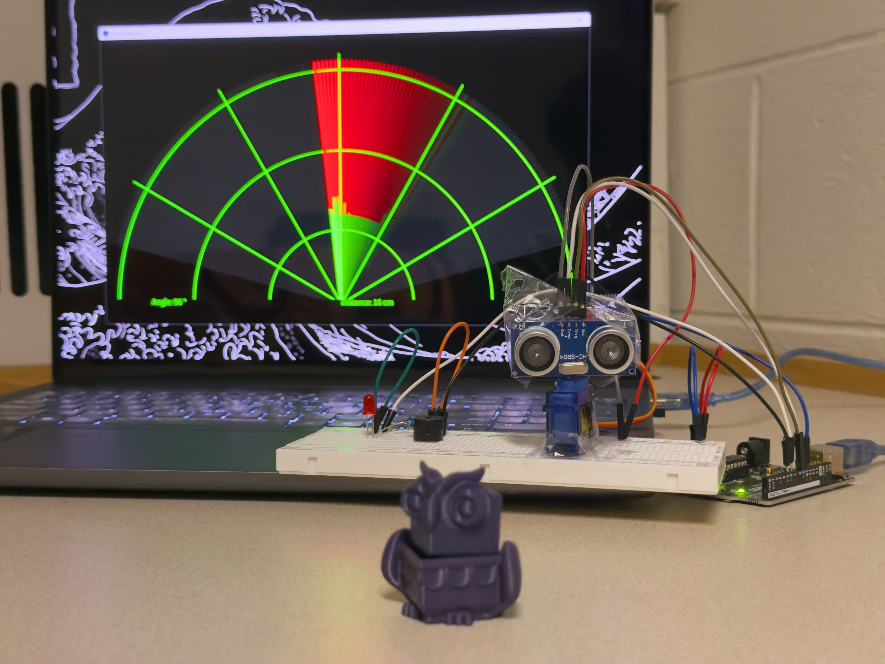
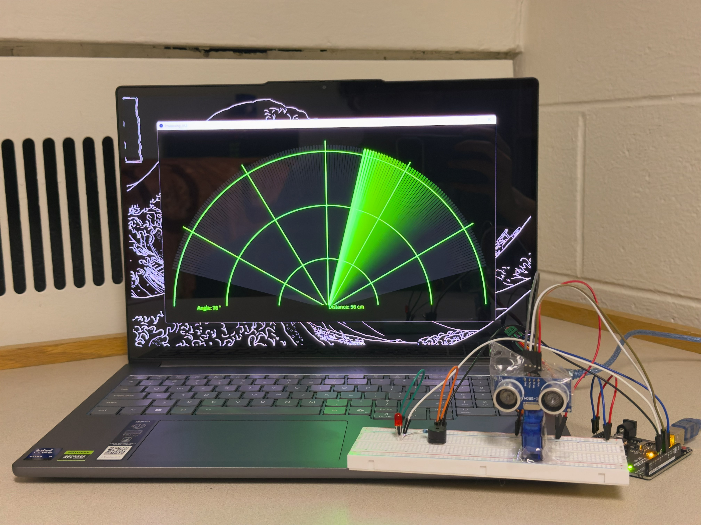
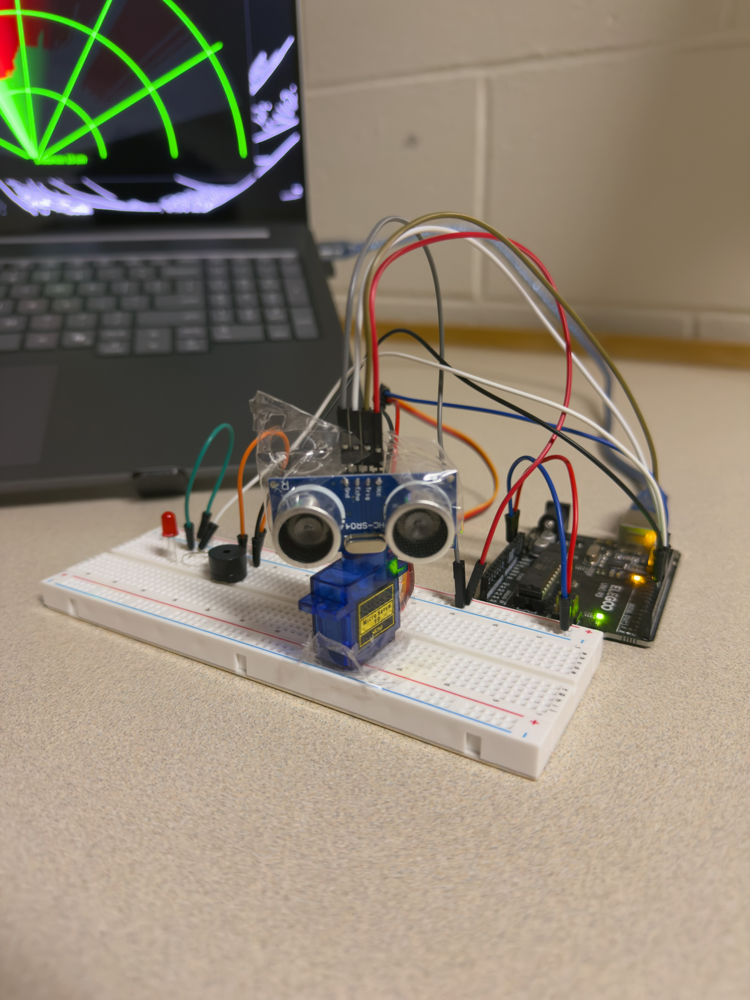

# Arduino Ultrasonic Radar & Proximity Alert System

A real-time ultrasonic radar prototype built using an Arduino, ultrasonic distance sensor, and servo motor. The system scans a 150° range to detect nearby objects and displays distance measurements through a custom graphical interface developed in Processing.

The project also incorporates an LED and buzzer that provide distance-dependent proximity alerts.

## Project Demonstration

### Hardware Setup

### Processing GUI

### Circuit Setup

### Video Demonstration

*Demonstration videos coming soon.*

## Features

- **150° Scanning Range:** Servo motor continuously sweeps between 15° and 165°.
- **Ultrasonic Distance Measurement:** Measures the distance to nearby objects using ultrasonic pulses.
- **Real-Time GUI:** Displays scanning angles, distance measurements, and object detection using Processing.
- **Proximity Alerts:** LED and buzzer activate when objects are detected within 40 cm.
- **Dynamic Alert Frequency:** LED flashes and buzzer beeps become faster as detected objects get closer.
- **Serial Communication:** Arduino transmits angle and distance measurements to Processing at 9600 baud.

## Hardware Components

- Arduino microcontroller
- Ultrasonic distance sensor
- Servo motor
- LED
- Buzzer
- Breadboard and jumper wires
- Resistors

## Software & Technologies

- **Arduino C++** — Sensor measurements, servo control, and proximity alert logic.
- **Processing (Java-based)** — Real-time radar visualization and graphical interface.
- **Serial Communication** — Transfers measurement data between Arduino and Processing.

## How It Works

1. **Scanning:** The Arduino rotates the servo motor from 15° to 165° and back.
2. **Distance Measurement:** The ultrasonic sensor emits a sound pulse and measures the time required for the reflected signal to return.
3. **Distance Calculation:** The Arduino calculates the approximate distance using the speed of sound.
4. **Data Transmission:** The Arduino sends angle and distance measurements through the serial port.
5. **Visualization:** Processing receives the measurements and displays them in a radar-style interface. Detected objects within 40 cm are highlighted in red.
6. **Proximity Alerts:** When an object is within 40 cm, the LED and buzzer activate with shorter on/off intervals as the object gets closer.

## How to Run

1. Assemble and connect the hardware using the pin assignments in the Arduino sketch.
2. Open the Arduino sketch in Arduino IDE.
3. Select the correct Arduino board and COM port.
4. Upload the sketch to the Arduino.
5. Open the Processing GUI sketch in Processing IDE.
6. Change the serial port in the Processing code (currently `COM3`) to match your Arduino.
7. Close the Arduino Serial Monitor if it's open, then run the Processing sketch.

## Future Improvements

- Implement distance filtering to reduce measurement noise.
- Add CSV data logging for analyzing sensor measurements.
- Improve object visualization and approximate object mapping.
- Explore more accurate sensing technologies for advanced mapping.

## Development Process

This project was developed with AI-assisted programming to help implement and refine the Arduino and Processing code. The system was physically assembled, integrated, and tested to create a working ultrasonic radar prototype.

Through this project, I gained hands-on experience with microcontrollers, ultrasonic sensors, servo motors, serial communication, and real-time visualization.

## Author

**Neil Pawar**

Electrical Engineering Student — Kettering University
